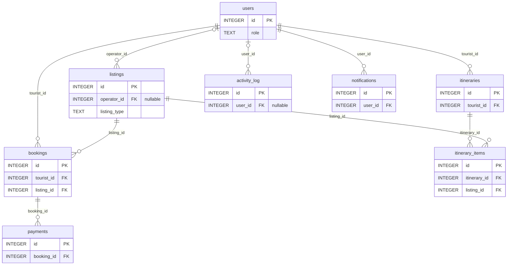

# Sarawak Tourism Information System (SWE30003 Assignment 3, Group 7)

A Flask web application implementing four areas of the Assignment 2
design: search and book accommodation, pay for a booking (simulated),
plan an itinerary, and manage listings.

## Requirements

- Python 3.12 or later

## Setting up

```bash
python -m venv venv
# Windows
venv\Scripts\activate
# macOS / Linux
source venv/bin/activate

pip install -r requirements-dev.txt
```

## Running

```bash
python run.py
```

Open http://127.0.0.1:5000 in a browser. The database
(`instance/stis.db`) and sample data are created on first start.
To start again with fresh data, stop the server and delete
`instance/stis.db`. Stop the server with Ctrl+C.

### Sample accounts

All sample accounts use the password `Password1!`.

| Role     | Email                  |
|----------|------------------------|
| Tourist  | tourist@example.com    |
| Operator | operator@example.com   |
| Operator | operator2@example.com  |
| Admin    | admin@example.com      |

## Checks

```bash
python -m compileall app     # compilation evidence
flake8                       # PEP 8 coding standard
pytest                       # automated tests
```

## Project structure

| Folder          | Contents                                        |
|-----------------|-------------------------------------------------|
| `app/models`    | Entity classes (User, Listing, Booking, ...)     |
| `app/controllers` | Workflow controllers (BookingManager, ...)    |
| `app/services`  | Shared services (Authenticator, Notifier, ...)   |
| `app/data`      | DataStore, schema and sample data                |
| `app/routes`    | One route module per area (UI boundary)          |
| `app/templates` | HTML screens                                     |
| `tests`         | Automated tests                                  |

## Database ER diagram

The diagram below shows the primary keys, foreign keys and main relationships
defined in [schema.sql](app/data/schema.sql). Other columns are omitted for
readability. `PK` means primary key and `FK` means foreign key.



### Main relationships

Each parent can have zero or many related records. `||` means exactly one
parent, `|o` means zero or one parent, and `o{` means zero or many children.

| Relationship | Meaning |
|--------------|---------|
| Users → listings | A user can manage multiple listings; a listing's `operator_id` may be NULL. |
| Users → bookings ← listings | Each booking belongs to one user and one listing. |
| Bookings → payments | Each payment belongs to one booking. A booking can have multiple payment records because `booking_id` is not unique. |
| Users → itineraries | Each itinerary belongs to one user. |
| Itineraries → itinerary_items ← listings | Each itinerary item links one itinerary to one listing, with a day and time slot. This supports a many-to-many relationship between itineraries and listings. |
| Users → activity_log | A user can have multiple log entries; `user_id` may be NULL. The `item` field is plain text, not a foreign key. |
| Users → notifications | Each notification belongs to one user. |

Deleting an itinerary automatically deletes its items (`ON DELETE CASCADE`).
Other foreign keys use SQLite's default `NO ACTION`: referenced parents cannot
be deleted while dependent records remain when foreign keys are enabled.
`DataStore` enables foreign-key enforcement for every connection.

The names `tourist_id` and `operator_id` describe intended roles, but their
foreign keys only enforce that the user exists. Role checks belong in the
application. There is no direct foreign key between bookings and itineraries.

## Who owns what

| Area / part                         | Owner   | Route module            |
|-------------------------------------|---------|-------------------------|
| Sign-in, app setup, DataStore       | Nathan  | `auth.py`, `main.py`    |
| Search and book accommodation       | Badrul  | `bookings.py`           |
| Pay for a booking                   | Zaferah | `payments.py`           |
| Plan an itinerary                   | Ivan    | `itineraries.py`        |
| Manage listings                     | Anisa   | `listings.py`           |
| Database, run instructions, checks  | Ivan    | `app/data`, `tests`     |

## Coding standard

PEP 8 (https://peps.python.org/pep-0008/) with PEP 257 docstrings
(https://peps.python.org/pep-0257/), checked with flake8. Every public
class and function has a docstring naming the responsibility it
implements. Route handlers contain no business rules.

## Working together

1. Create a branch for your area: `git checkout -b area/bookings`.
2. Commit small, working steps.
3. Run `flake8` and `pytest` before pushing.
4. Open a pull request and ask one other member to review it.
